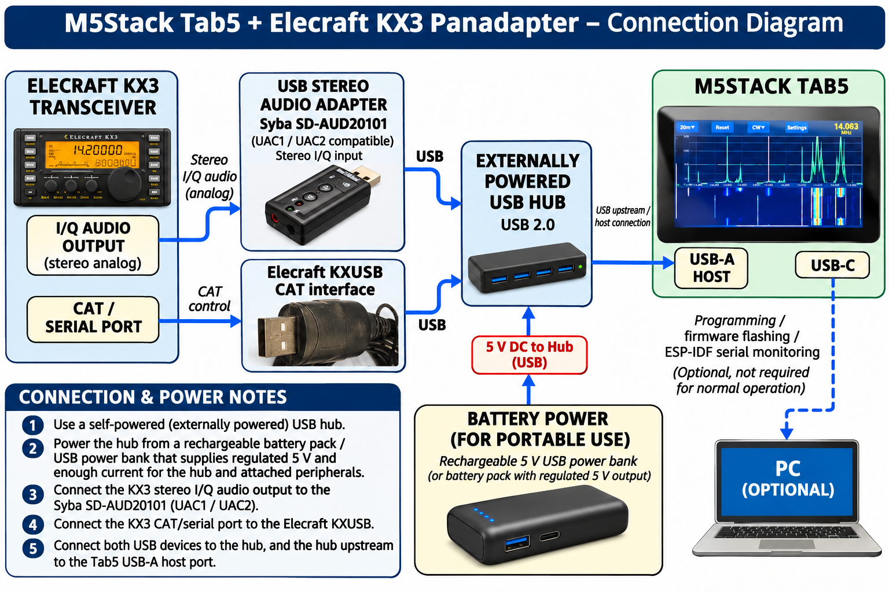

# KX3 Panadapter for the M5Stack Tab5

A portable, real-time panadapter for the **Elecraft KX3** transceiver, built around the **M5Stack Tab5** development platform (ESP32-P4). The application uses the KX3's quadrature I/Q audio output to display signals around the current receive frequency, with a spectrum display, scrolling waterfall, and CAT frequency synchronization.

## Background

This project was inspired by the [QMX panadapter](https://github.com/SteffenLav/qmx-panadapter) created by Steffen Lav. That project is extensive and supports more than panadapter functionality. The goal here is a straightforward, easy-to-use panadapter for the KX3.

Unlike radios that provide digital audio directly over USB, the KX3 does not have a USB port carrying its digital audio stream. The KX3's analog I/Q output therefore requires an external stereo USB audio interface. A USB hub is also required in the current tested hardware configuration to connect the audio interface and CAT adapter to the Tab5.

## Overview

The KX3 Panadapter is an external real-time spectrum display. It captures the KX3's quadrature (I/Q) audio, processes the two channels, and displays signal activity around the receiver's current frequency.

The application transforms the Tab5 into a portable panadapter, showing activity across the receiver's passband and providing a scrolling waterfall to visualize signal activity over time. It is implemented with ESP-IDF and runs on the ESP32-P4 processor in the M5Stack Tab5.

## System architecture

The system consists of four primary components:

- **Elecraft KX3 transceiver** — provides the receiver's I/Q audio output and CAT information.
- **USB stereo audio interface** — converts the analog I and Q signals into digital audio samples.
- **USB hub** — connects the audio interface and CAT interface to the Tab5 in the tested configuration.
- **M5Stack Tab5** — captures, processes, and displays the digital I/Q data.

The USB audio interface and CAT adapter connect to the Tab5 through a USB hub. Hub and peripheral compatibility can vary with device implementation and power requirements.

The current application uses a stereo USB audio interface operating at **48 kHz**. The interface must provide two simultaneous input channels so that the separate I and Q signals are captured independently. The USB audio device must also enumerate and operate with the ESP32-P4 USB host implementation.

## Spectrum display

The panadapter displays the calculated spectrum across the available screen width. Features include:

- Real-time spectrum visualization.
- Signal amplitude displayed in relative dBFS units.
- Adjustable averaging to reduce noise and stabilize the display.
- Baseline calculation and reset functionality.
- Frequency markers and touch-based frequency selection.
- Frequency-range adjustment through touch-and-drag gestures.
- Display scaling and configuration controls.

The spectrum is centered around the KX3's current receive frequency. Changes made with the radio's tuning controls are reflected in the displayed frequency range.

## Waterfall display

A scrolling waterfall is positioned below the spectrum. Each spectrum update contributes a horizontal line to the waterfall. Signal amplitude is represented by color intensity, providing a historical view of band activity.

The waterfall makes it easier to identify intermittent signals, weak signals, frequency occupancy, and changes in propagation. The waterfall scroll rate and display parameters can be adjusted through the application settings.

## Radio-frequency synchronization

The application is designed to remain synchronized with the KX3's operating frequency.

- Frequency changes made using the KX3's tuning controls update the panadapter.
- Touch interaction with the spectrum allows the user to select a frequency.
- Touch-and-drag gestures adjust the displayed frequency range.

## User interface

The primary display includes:

- Spectrum display.
- Waterfall display.
- Current operating frequency.
- Band and operating-mode information.
- Frequency selection and navigation.
- Baseline reset control.
- Settings panel.

The settings panel provides access to display and signal-processing parameters, including averaging time and waterfall behavior.

## Hardware requirements

### Required hardware

- M5Stack Tab5 (ESP32-P4).
- Elecraft KX3 transceiver with I/Q output enabled.
- Elecraft KXUSB interface, or a supported FTDI-based CAT interface.
- Stereo USB audio interface with two simultaneous input channels.
- USB hub compatible with the Tab5 USB host implementation.
- Appropriate audio and USB cables.
- A separate power source for the USB hub for portable operation.

### USB audio interface requirements

The audio interface must support:

- Two simultaneous input channels (stereo capture).
- A 48 kHz sampling rate.
- USB Audio Class operation compatible with the Tab5's USB host implementation.

The KX3 provides separate I and Q signals. Both channels are required for the application's quadrature processing and image rejection. USB sound cards with only a mono microphone input are not suitable.

USB Audio Class compatibility is important. Compatibility with Windows or macOS does not guarantee compatibility with the ESP32-P4 USB host. The application includes support paths for USB Audio Class 1 and USB Audio Class 2 devices, but individual device compatibility should be verified.

### USB hub and power

A USB hub is required for the current tested hardware configuration to connect the USB audio interface and CAT adapter to the Tab5.

Use a **self-powered hub** for portable operation. The hub should provide regulated **5 V** from its own battery or power source and sufficient current for the audio interface and CAT adapter. Do not assume the Tab5 USB-A port can power both peripherals through an unpowered hub.

Direct connection of compatible USB audio interfaces may be possible in other configurations, but it has not been established as a generally supported configuration.

The optional Tab5 USB-C connection to a PC is used for development, flashing, and serial monitoring. It is not required during normal portable operation.

### Hardware connection diagram



Connection overview:

1. Connect the KX3 I/Q audio output to the stereo USB audio interface.
2. Connect the KX3 CAT interface to the Elecraft KXUSB (or supported CAT adapter).
3. Connect both USB peripherals to the USB hub.
4. Connect the hub to the Tab5 USB-A host port.
5. Power the hub from its separate regulated 5 V battery/power source.
6. Optionally connect the Tab5 USB-C port to a PC for programming and serial monitoring.

## Software architecture

The application uses:

- ESP-IDF.
- ESP32-P4.
- ESPP M5Stack Tab5 board-support package.
- LVGL graphics library.
- USB host audio functionality.
- FFT-based signal processing.

The software is organized around audio acquisition, signal processing, display rendering, and user interaction. The audio subsystem receives stereo samples from the USB audio interface. The signal-processing subsystem performs FFT analysis and spectrum calculations. The display subsystem renders the panadapter and waterfall, while the user-interface subsystem handles touch input, configuration, and frequency navigation.

## Performance

The application is designed for continuous real-time spectrum monitoring. Performance depends on the USB audio interface, USB hub, FFT configuration, display rendering workload, and graphics-processing overhead.

Performance instrumentation is included for monitoring loop execution time, spectrum update rate, and processing overhead. These measurements are used to optimize responsiveness and display refresh performance.

## Building the project

### Tested development environment

The current repository version has been built and run on the Tab5 using:

| Item | Version / target |
|---|---|
| ESP-IDF | **6.1.0** |
| Chip target | **ESP32-P4** |
| C++ language standard | **C++23** |
| ESPP Tab5 BSP | **1.4.6** |
| LVGL | **9.5.0**, as resolved by the included dependency lockfile |

The original development environment used an unreleased LVGL 9.6.0-dev build. The repository's component-manager dependency set resolves LVGL 9.5.0; the user has confirmed that this repository configuration builds and runs with the updated Tab5 BSP.

### Prerequisites

1. Install **ESP-IDF 6.1.0** and its required tools using the official [Espressif ESP-IDF installation guide](https://docs.espressif.com/projects/esp-idf/en/v6.1/esp32p4/get-started/index.html).
2. Use an ESP-IDF terminal (or the ESP-IDF PowerShell environment) so that `IDF_PATH`, Python, CMake, Ninja, and the Xtensa/RISC-V toolchains are configured.
3. Obtain this repository and open the ESP-IDF terminal in the repository's root directory.

### Configure and build

Run the following commands from the repository root:

```powershell
idf.py set-target esp32p4
idf.py reconfigure
idf.py build
```

The ESP Component Manager reads `main/idf_component.yml` and downloads the managed dependencies during configuration. The repository includes `dependencies.lock` to record the dependency versions used for the working build. Keep this file under version control so that subsequent builds can reproduce the resolved component set.

### Flash and monitor

Connect the Tab5 to the development PC using its USB-C port. Identify the serial port assigned by Windows, then run:

```powershell
idf.py -p COMx flash monitor
```

Replace `COMx` with the actual COM port for the Tab5.

To build without flashing:

```powershell
idf.py build
```

To clean generated build output:

```powershell
idf.py fullclean
```

### Repository contents and dependencies

- `main/` — panadapter application source and component manifest.
- `components/usb_host/` — local ESPP USB Host wrapper used by the application.
- `components/espressif__usb_host_uac/` — local USB Audio Class 1 host component.
- `components/usb_host_uac2/` — local USB Audio Class 2 host component.
- `docs/hardware-setup.png` — hardware connection diagram.
- `dependencies.lock` — resolved ESP Component Manager dependency versions.
- `sdkconfig.defaults` — project configuration defaults.
- `partitions.csv` — custom partition layout.

The ESPP framework, Tab5 BSP, and other registry dependencies are declared in `main/idf_component.yml` and are retrieved by the ESP Component Manager. Generated `managed_components/`, `build/`, and machine-specific `sdkconfig` files are intentionally not included in the repository.

## Troubleshooting

- **Component download or resolution errors:** Check that the ESP-IDF environment is active and that the computer can reach the Espressif Component Registry. Keep `dependencies.lock` with the project.
- **USB audio device does not enumerate:** Check the hub, USB cable, device compatibility, and available hub power. A device working on a PC is not necessarily compatible with the ESP32-P4 USB host implementation.
- **No stereo I/Q capture:** Verify that the audio interface exposes two simultaneous capture channels and is configured for 48 kHz.
- **CAT frequency does not update:** Check the KXUSB/FTDI connection, USB hub, and the selected CAT interface.
- **USB peripherals disconnect or behave erratically:** Use a separately powered hub with a regulated 5 V supply and adequate current capacity.

## Project goals

The primary goals are to:

- Provide a portable panadapter for the Elecraft KX3.
- Use inexpensive and readily available USB audio hardware.
- Provide real-time spectrum and waterfall visualization.
- Enable intuitive frequency selection using the Tab5 touchscreen.
- Provide a configurable display and signal-processing interface.
- Develop a hardware and software configuration that other amateur-radio operators can reproduce.

## Status

This project is under active development. The application has been confirmed by the developer to build and run on the M5Stack Tab5 using the dependency versions recorded in this repository. A separate fresh-clone build has not yet been independently verified.

Hardware compatibility, USB audio interface support, signal processing, user-interface functionality, and performance may continue to evolve. Contributions and reports about additional compatible USB audio interfaces are welcome.
